 

  

<h2 align="center">⌁ C & systems</h2>

<table>
  <tr>
    <td align="center" width="50%" valign="top">
      
      <h3><a href="https://github.com/simPly-invent/shell_C">shell_C</a></h3>
      A Bash-like shell: tokenizer, AST parser, pipes, redirections, heredocs, builtins and signals.  
        
    </td>
    <td align="center" width="50%" valign="top">
      
      <h3><a href="https://github.com/simPly-invent/codexion">codexion</a></h3>
      N coders fight over USB dongles before they burn out. One POSIX thread each, FIFO or EDF scheduling.  
        
    </td>
  </tr>
  <tr>
    <td align="center" width="50%" valign="top">
      
      <h3><a href="https://github.com/simPly-invent/tester_codexion">tester_codexion</a></h3>
      Automated test suite for codexion: arguments, fairness, burnout timing, data races.  
       
    </td>
    <td align="center" width="50%" valign="top">
      
      <h3><a href="https://github.com/simPly-invent/Function-library-C">libft</a></h3>
      43 libc functions rewritten from scratch, the base of every later C project.  
        
    </td>
  </tr>
  <tr>
    <td align="center" width="50%" valign="top">
      
      <h3><a href="https://github.com/simPly-invent/ft_printf">ft_printf</a></h3>
      printf rebuilt with nothing but <code>write()</code>, tested side by side with the real one.  
       
    </td>
    <td align="center" width="50%" valign="top">
      
      <h3><a href="https://github.com/simPly-invent/get-next-line">get_next_line</a></h3>
      Read any file descriptor one line at a time, several fds at once.  
       
    </td>
  </tr>
  <tr>
    <td align="center" colspan="2" valign="top">
      
      <h3><a href="https://github.com/simPly-invent/C_pomodoro">C_pomodoro</a></h3>
      A colourful terminal Pomodoro timer.  
       
    </td>
  </tr>
</table>

<h2 align="center">⌁ Python & AI</h2>

<table>
  <tr>
    <td align="center" width="50%" valign="top">
      
      <h3><a href="https://github.com/simPly-invent/RAG-against-the-machine">RAG against the machine</a></h3>
      Ask questions about the vLLM codebase: smart chunking, BM25 retrieval, local LLM answers.  
        
    </td>
    <td align="center" width="50%" valign="top">
      
      <h3><a href="https://github.com/simPly-invent/Fly-in">Fly-in</a></h3>
      Route a drone fleet through a capacity-limited network in as few turns as possible.  
        
    </td>
  </tr>
  <tr>
    <td align="center" width="50%" valign="top">
      
      <h3><a href="https://github.com/simPly-invent/A-Maze-ing">A-Maze-ing</a></h3>
      Maze generator (DFS, Growing Tree) with a hidden "42" and a BFS solver.  
        
    </td>
    <td align="center" width="50%" valign="top">
      
      <h3><a href="https://github.com/simPly-invent/pac_man">pac_man</a></h3>
      Pac-Man on freshly generated mazes, four ghosts with their own minds. Built with pamuller.  
        
    </td>
  </tr>
  <tr>
    <td align="center" colspan="2" valign="top">
      
      <h3><a href="https://github.com/simPly-invent/grademe_python_RANK3">grademe_python</a></h3>
      A local examshell clone to train for the 42 Rank 03 Python exam.  
       
    </td>
  </tr>
</table>

<h2 align="center">⌁ Also on the workbench</h2>

<table>
  <tr>
    <td width="50%" valign="top">
      🐳 <b><a href="https://github.com/simPly-invent/inception">inception</a></b> 
      nginx + WordPress + MariaDB, each in a hand-built Docker container, wired with Compose.
    </td>
    <td width="50%" valign="top">
      🧠 <b><a href="https://github.com/simPly-invent/call_me_maybe">call_me_maybe</a></b> 
      Function calling with a 0.6B LLM and constrained decoding: 100% valid JSON.
    </td>
  </tr>
  <tr>
    <td width="50%" valign="top">
      👾 <b><a href="https://github.com/simPly-invent/PALE-COPIE">PÂLE COPIE</a></b> 
      A 2D RPG in Godot 4 where every room is a slightly more degraded copy of the last.
    </td>
    <td width="50%" valign="top">
      🛸 <b><a href="https://github.com/simPly-invent/the_watCh3r">the_watCh3r</a></b> 
      An autonomous home surveillance drone, and its <a href="https://simply-invent.github.io/the_watCh3r/">campaign site</a>.
    </td>
  </tr>
  <tr>
    <td colspan="2" align="center" valign="top">
      🎟️ <b><a href="https://github.com/simPly-invent/_piscine_">TicketStorm</a></b> 
      A bot-training arena on Cloudflare Workers: grab the tickets before ten detection layers catch you.
    </td>
  </tr>
</table>

  <code>$ exit</code> · thanks for stopping by

