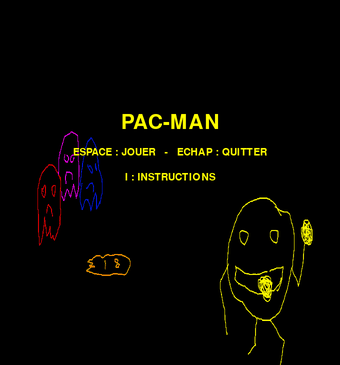

# Hi, I'm mobenais 👋

**Computer science student at 42 Lyon**

I like low-level C, Python tooling and building things that actually run:
shells, simulations, games, and a drone.

---

## 🎬 Showcase

### C and systems

<table>
  <tr>
    <td align="center" width="50%">
      <a href="https://github.com/simPly-invent/shell_C"><b>shell_C</b></a> 
      Minishell: a Bash-like shell with pipes, redirections, heredocs, builtins and signals  
      
    </td>
    <td align="center" width="50%">
      <a href="https://github.com/simPly-invent/codexion"><b>codexion</b></a> 
      Multithreaded simulation: pthreads, mutexes, condition variables, FIFO/EDF scheduling  
      
    </td>
  </tr>
  <tr>
    <td align="center" width="50%">
      <a href="https://github.com/simPly-invent/tester_codexion"><b>tester_codexion</b></a> 
      Automated test suite for codexion: arguments, fairness, burnout, data races  
      
    </td>
    <td align="center" width="50%">
      <a href="https://github.com/simPly-invent/Function-library-C"><b>Function-library-C</b></a> 
      libft: 43 libc functions re-implemented as a static library  
      
    </td>
  </tr>
  <tr>
    <td align="center" width="50%">
      <a href="https://github.com/simPly-invent/ft_printf"><b>ft_printf</b></a> 
      printf re-implemented with write() only  
      
    </td>
    <td align="center" width="50%">
      <a href="https://github.com/simPly-invent/get-next-line"><b>get-next-line</b></a> 
      Read a file descriptor line by line with a static buffer  
      
    </td>
  </tr>
  <tr>
    <td align="center" colspan="2">
      <a href="https://github.com/simPly-invent/C_pomodoro"><b>C_pomodoro</b></a> 
      A terminal Pomodoro timer  
      
    </td>
  </tr>
</table>

### Python

<table>
  <tr>
    <td align="center" width="50%">
      <a href="https://github.com/simPly-invent/RAG-against-the-machine"><b>RAG-against-the-machine</b></a> 
      Retrieval-augmented generation over the vLLM codebase: chunking, BM25 index, local LLM answers  
      
    </td>
    <td align="center" width="50%">
      <a href="https://github.com/simPly-invent/Fly-in"><b>Fly-in</b></a> 
      Drone fleet routing simulator: BFS, edge-disjoint paths, turn-by-turn simulation  
      
    </td>
  </tr>
  <tr>
    <td align="center" width="50%">
      <a href="https://github.com/simPly-invent/A-Maze-ing"><b>A-Maze-ing</b></a> 
      Maze generator (DFS, Growing Tree) and BFS solver with terminal and MLX rendering  
      
    </td>
    <td align="center" width="50%">
      <a href="https://github.com/simPly-invent/pac_man"><b>pac_man</b></a> 
      Pac-Man in pygame with generated mazes, written with pamuller  
      
    </td>
  </tr>
  <tr>
    <td align="center" colspan="2">
      <a href="https://github.com/simPly-invent/grademe_python_RANK3"><b>grademe_python_RANK3</b></a> 
      Local examshell clone to practice the 42 Rank 03 Python exercises  
      
    </td>
  </tr>
</table>

---

## 📂 More projects

| Project | What it is |
|---------|------------|
| [inception](https://github.com/simPly-invent/inception) | nginx + WordPress + MariaDB in Docker containers built from scratch, orchestrated with Compose |
| [call_me_maybe](https://github.com/simPly-invent/call_me_maybe) | Function calling with a 0.6B LLM and constrained decoding for 100% valid JSON |
| [PALE-COPIE](https://github.com/simPly-invent/PALE-COPIE) | Undertale-style 2D RPG in Godot 4 where every room is a degraded copy of the last |
| [the_watCh3r](https://github.com/simPly-invent/the_watCh3r) | Autonomous home surveillance drone and its [campaign website](https://simply-invent.github.io/the_watCh3r/) |
| [_piscine_](https://github.com/simPly-invent/_piscine_) | TicketStorm: a bot-training platform on Cloudflare Workers with ten bot-detection layers |

---

## 🛠️ Tools I use

C, Python, GDScript, Docker, Git, Linux, pthreads, pygame, Godot, Cloudflare Workers.
